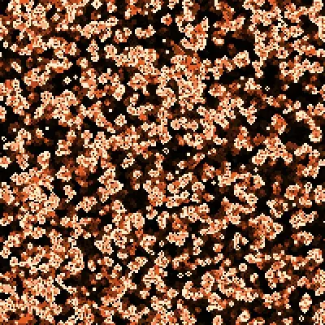
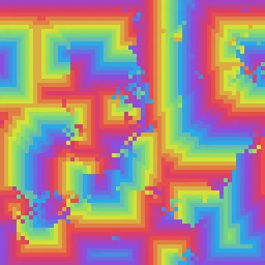
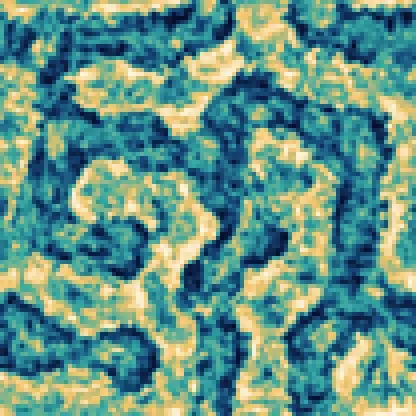
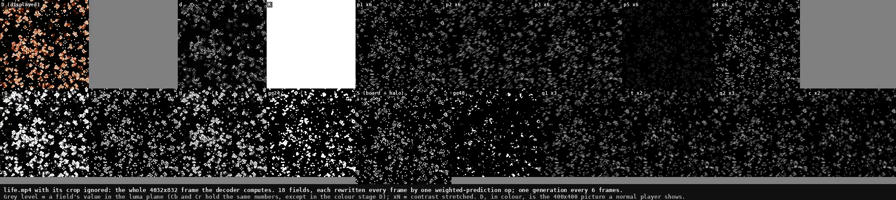
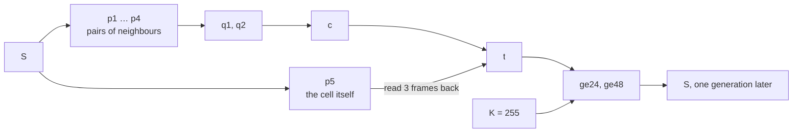
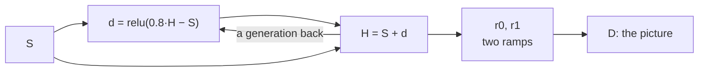
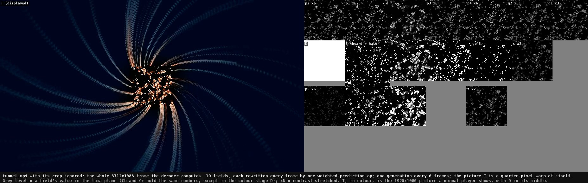

# H.264 CPU

Standard H.264 videos that compute. Each file holds a starting state and one small *program* frame,
repeated. The video decoder in your browser, phone or media player computes the pictures while the
video plays. The main program is Conway's Game of Life, which is Turing complete. So explicit weighted
prediction, a feature added to H.264 for fades, is enough to build a universal computer, limited only
by the size of the frame. In `tunnel.mp4` the decoder also zooms and turns a 1920×1080 picture of the
board's history, interpolating at quarter-pixel precision.

**[Draw a pattern and watch your own browser's decoder run it, forever →](https://fmindstormer.github.io/h264cpu/)** ·
[Download the videos](https://github.com/fMindstormer/h264cpu/releases/latest)

*`tunnel.mp4`: the live board in the middle; each streak is the history of one cell on its edge, one notch
per generation.*

<table>
<tr>
<td></td>
<td></td>
<td></td>
</tr>
<tr><td><code>life.mp4</code></td><td><code>spiral.mp4</code></td><td><code>turing.mp4</code></td></tr>
</table>

| Video | Program | Picture | In 30 s at 60 fps | File |
|---|---|---|---|---|
| `tunnel.mp4` | Life on a 128×128 torus, in the middle of a picture the decoder zooms and turns from its own previous frame | 1920×1080 | 299 generations | 46.4 MB; 24.7 KB program frame |
| `life.mp4` | Conway's Game of Life (B3/S23) on a 200×200 torus | 400×400 | 298 generations | 10.0 MB; 2.7 KB program frame |
| `spiral.mp4` | Cyclic cellular automaton, 14 states, on a 64×64 torus | 128×128 | 199 generations | 7.2 MB; 2.8 KB program frame |
| `turing.mp4` | Multi-scale Turing patterns, after Jonathan McCabe, on a 104×104 torus | 208×208 | 1,793 steps | 21.6 MB; 11.6 KB program frame |

All four files use H.264 Main profile at level 5.1, and every build checks that they stay within that
level's limits. The 16 copies of each program frame differ only in a 4-bit frame counter. The
[page](https://fmindstormer.github.io/h264cpu/) needs no file at all: it hands your browser's decoder the
program frames through WebCodecs for as long as the tab is open.

**Inside:** [one macroblock is one instruction](#one-macroblock-is-one-instruction) ·
[the computation model](#the-computation-model) · [from a program to frames](#from-a-program-to-frames) ·
[the programs](#programs) · [running forever in a browser](#running-forever-in-a-browser) ·
[clock speed](#clock-speed) · [how it is checked](#how-it-is-checked) · [notes from the work](#notes-from-the-work)

## One macroblock is one instruction

A video decoder rebuilds most of each picture from pictures it has already decoded. In a B frame, every
16×16 macroblock is a prediction:

1. **Where from.** A motion vector says which block of an earlier picture to copy. It can point far
   away: at this level, up to 2048 pixels sideways and 512 up or down.
2. **Which picture, and how much of it.** A reference index picks an entry in one of two reference
   lists. An entry names an earlier picture and carries a weight and an offset for each colour plane. A
   slice builds its own lists, and it may name the same picture many times with different weights.
3. **Mix.** With explicit weighted prediction, a macroblock that reads from both lists computes, for
   every sample,

       clip(((w0·a + w1·b + 2^L) >> (L+1)) + o)

   and one that reads from a single list computes clip(((w·a + 2^(L−1)) >> L) + o). Weights and offsets
   are integers from −128 to 127, and L, the log2 of the weights' denominator, runs from 0 to 7.
4. **Nothing else.** Encoders normally send a residual that corrects the prediction, and a deblocking
   filter smooths the edges between blocks. These files send no residual and switch deblocking off, so
   every decoded sample is exactly the prediction.

Together that is an instruction: two loads from up to 16 earlier frames, a multiply-add with constant
weights, and a saturating 8-bit store. A frame runs one instruction per macroblock, all of
them at once, and the next frame can read the results. The rest of this README is about building a
computer out of that, and about what it took to make real decoders run it.

## The computation model

**Fields and cells.** A program is a set of *fields*: square boards of cells, each in its own region of
one large frame.
- A cell is 2×2 luma pixels and one chroma sample (chroma is stored at half resolution), so a field is
  three boards, Y, Cb and Cr, that compute in lockstep. Weights may differ per plane.
- In every frame, one op rewrites every macroblock of a field, so an op is a single SIMD instruction over
  the whole board.
- An op's motion vectors make it read other fields, shifted by a fixed number of cells.

**Clock and memory.** A frame is one tick of the clock. An op reads fields from 1 to 8 frames back,
which the decoder still holds as reference pictures: the decoded picture buffer is the machine's memory.
A field that is read at an offset carries an 8-cell halo. Life's board is one such field: it is read
for its neighbours. The field's own op fills the halo through wrapped motion vectors, so boards are tori.

**Instructions.** Two inputs, constant weights, 8 bits and a clip give these building blocks:

| Operation | Weighted prediction | Used for |
|---|---|---|
| a + b, saturating | L = 0, weights 2 and 2 | Life's neighbour counts |
| a − b, clipped at 0 (a ReLU) | L = 0, weights 2 and −2 | Life's new board, `S = ge24 − ge48` |
| exact average, (a + b + 1) >> 1 | L = 6, weights 64 and 64 | the Turing program's blur pyramid |
| scale and shift | one input: ((w·a + 2^(L−1)) >> L) + o | Life's `p5`: 8 if the cell is alive |
| threshold | steep weights against `K`, a constant field of 255: 0 below one value, 255 above another | Life's `ge24` and `ge48` |
| NOT and OR, on 0 and 255 | 255 − a (against `K`); a + b | the spiral's OR tree |
| min and max | two ops each: a − relu(a − b); b + relu(a − b) | the Turing min tree; Life's glow |
| select | mask each candidate with a steep offset, then add | the spiral's next state |
| colour | ramps, then weighted pairs per plane at L = 6 | every display |

AND is a threshold on the average, so every Boolean gate takes one or two ops. In a bi-prediction,
w0 + w1 must stay between −128 and 128, which is why steep weights come in opposing pairs, as in a
threshold against `K`.

**Pipelines.** An op reads earlier frames, so a chain of ops takes one frame per op. Every op still runs
in every frame, so a program is a pipeline. Life's chain has six stages, so it holds six interleaved
copies of its computation.
- The writer fills every stage from the same starting board, so the six copies stay equal and the
  board advances once every six frames.
- Delays line inputs up. Life's `t` adds `c`, read one frame back, to `p5`, read three frames back,
  because `p5` comes two stages earlier in the chain.

**What it can compute.** Every Boolean circuit, at one or two frames per gate of depth. With reference
pictures as registers, every finite-state machine. The Game of Life is itself Turing complete (Berlekamp, Conway
and Guy, *Winning Ways*, 1982), and Paul Rendell built a Turing machine in it in 2000. So the decoder is
a universal computer in the sense that any real computer is one: up to its memory, here a 200×200 torus.

**What it cannot.**
- *Choose addresses.* Motion vectors are written into the program frame, which never changes. A program
  is a circuit wired by motion vectors, closer to an FPGA bitstream than to code.
- *Multiply two variables.* Weights belong to list entries, so they are constants. Squaring a number, as
  a Mandelbrot iteration does, is out of reach, and so is precision beyond 8 bits.
- *Scale.* Blocks are translated, never scaled or rotated. The tunnel builds zoom and rotation out of
  thousands of slightly different translations.
- *Avoid rounding.* Every op rounds and clips. The programs either stay exact (integers at L = 0,
  (a + b + 1) >> 1 at L = 6) or use the rounding on purpose (the tunnel's colours).

*`life.mp4` with its crop ignored, at half size: the 18 fields in the top band (L = 6) and the bottom band
(L = 0). Grey levels are field values; fields with small values are contrast-stretched, as their labels
say. The `glassbox` command renders this view as a video.*

## From a program to frames

`machine.py` turns fields and ops into B-frame syntax, and simulates, sample by sample, what a decoder
must output. Every piece of the syntax came with a constraint.

**Reference lists.** A frame slice can have at most 16 entries per list.
- Entry 0 of both lists is a plain copy of the previous frame.
- Ops with the same delay, weights and offsets share an entry. When a list would overflow, the writer
  starts a new slice.
- The lists are built by modification commands that count back from the current frame, so "three
  frames back" is the same command in every frame.

**Slices and precision.** L is set per slice, so fields that need L = 6 (averages, colour mixes) share a
band of the frame, and a slice starts wherever L changes. Life needs 2 slices. The tunnel, with its
picture beside the fields, needs 101. Level 5.1 allows 682 at 60 fps.

**Skipped macroblocks.** The decoder makes its own guess of each macroblock's references and motion,
from its left, top and top-right neighbours: *direct prediction*. When that guess is exactly what the
op needs, the macroblock is coded as B_Skip, which is almost free.
- Inside a field every macroblock reads like its neighbours. So the writer runs the decoder's derivation
  for each macroblock and codes only the ones where the guess fails: mostly each field's top row and
  left column, and its halo.
- In Life, 12,272 of the 13,104 macroblocks (94%) are skipped. That is why the program frame is only
  2.7 KB.
- One rule of direct prediction could have broken this. When the co-located block of a reference picture
  is still, it forces zero motion on any skipped block that uses reference index 0. Index 0 is the plain
  copy, which only unused macroblocks use, and only with zero motion, so the rule never changes a result.

**The same frame, 16 times.** A slice header carries `frame_num`, here 4 bits, which counts frames and
wraps. With picture order count type 2, display order is decode order and the headers carry no other
counter. So the program frames differ only in those 4 bits: the file is 16 different frames, repeated.

**Starting the machine.**
- Frame 0 is an IDR frame. Intra prediction with no neighbours and no residual gives exactly 128, so the
  frame is flat grey except for the first picture, stored as raw I_PCM samples.
- P frames then carry the rest of the starting state as I_PCM, in chunks small enough for the level's
  size limit on one frame.
- Skipped copies follow until the longest delay reaches the starting state.
- Then the program frames repeat.

**Fitting level 5.1.** A decoder that supports level 5.1 must handle any stream within its limits, so
every build checks them:

| Level 5.1 limit | `life.mp4` | `tunnel.mp4` |
|---|---|---|
| 983,040 macroblocks per second | 786,240 | 946,560 |
| 36,864 macroblocks per frame | 13,104 | 15,776 |
| 682 slices per frame, at 60 fps | 2 | 101 |
| Frame 0: 192 bytes per macroblock of the frame | 0.29 of 2.52 MB | 0.13 of 3.03 MB |
| Any later frame: 3.1 MB | 2.3 MB | 2.0 MB |
| Vertical motion vectors: −512 to 511.75 pixels | −416 to 418 | −288 to 288 |
| Reference list entries: 16 | 7 | 6 |

**Players.**
- *Crop.* The SPS crop window shows players only the display field. QuickTime and the Claude desktop app
  decode through Apple's VideoToolbox, and they ignore the window's left and top offsets. So the display
  field always sits at the frame's top-left corner, where only right and bottom offsets are needed.
- *Colour.* The stream marks its samples as full range with the BT.601 matrix, so the values a program
  computes are exactly the colours shown. The palettes are worked out in YCbCr.
- *Container.* `mp4.py` writes a minimal MP4, moov first, like `ffmpeg -c copy` does. Its samples are the
  access units unchanged, with the parameter sets in-band. The page's JavaScript writes the same file
  byte for byte.

## Programs

### Life in 18 fields

| Field | Weighted prediction | Value |
|---|---|---|
| `p1` … `p4` | (8·a + 8·b + 64) >> 7, L = 6, two neighbours each | 16 per live neighbour (cells are 0 or 255) |
| `p5` | (2·a + 32) >> 6, L = 6 | 8 if the cell itself is alive |
| `q1`, `q2`, `c` | a + b, then a + b − 16 | 16 × neighbours − 16 |
| `t` | c + p5, with p5 read 3 frames back | 16 × neighbours + 8 × alive − 16 |
| `ge24`, `ge48` | steep weights against a constant field `K` | 255 if t ≥ 24; 255 if t ≥ 48 |
| `S` | ge24 − ge48 | alive next ⇔ 24 ≤ t ≤ 40 ⇔ 3 neighbours, or 2 and alive |
| `d`, `H` | relu(0.8·H − S), then S + d | a glow: max(alive, 0.8 × last generation's glow) |
| `r0`, `r1`, `D` | two ramps, then one three-colour mix at L = 6 | the picture |

Every arrow is a read from an earlier frame. The rule is a six-stage pipeline from the board back to
the board, so the board advances every 6 frames:

The picture is a glow, then a colour map:

### Spiral waves

`spiral.mp4` runs David Griffeath's cyclic cellular automaton: 14 states on a 64×64 torus, where a cell
advances to the next state when a neighbour already holds it. States are stored as 9k, from 0 to 117.
Spaced out like that, comparisons with integer weights can tell a neighbour one state ahead from every
other difference, including across the wrap from 13 back to 0. One generation takes 69 fields and 9
stages:
- neighbour differences, `g0` … `g7`: 127 + neighbour − cell;
- comparisons against `K`, `up`, `hi` and `wr`, that pick out a neighbour exactly one state ahead
  (`win`), including across the wrap;
- an OR tree, `t1` … `adv`: does any neighbour match?
- the next state: `u` = cell + 9, `z` = 255 if the cell is in the last state, and `nx` = u, or 0 where
  `z` is set;
- selection: `keepN` keeps the next state where a neighbour matched, `keepO` the old one elsewhere,
  and `S` adds them.

### Turing patterns

`turing.mp4` runs Jonathan McCabe's multi-scale Turing patterns on a 104×104 torus, in 70 fields:
- **A blur pyramid.** `T1` … `B5` are pairs of averages, each level twice as wide as the last. At L = 6,
  (64a + 64b + 64) >> 7 is exactly (a + b + 1) >> 1.
- **Four scales.** At each scale, the activator (one blur) minus the inhibitor (the next) is taken apart
  into its sign and its size.
- **A min tree** (a − relu(a − b), two frames per level) finds the scale where the two blurs differ
  least. That scale moves the cell towards its activator, by a step of 1 to 3.
- **A slow pull** keeps values away from the clipping edges, in place of McCabe's normalisation.

The state takes one step every frame, using blurs a few frames old. That lag is the price of one layer
per frame, and the patterns still form.

### The tunnel: fractional motion

`tunnel.mp4` adds a second kind of field. A *picture field* is a plain region of pixels, rewritten by a
*warp*: each of its macroblocks copies an earlier frame at its own motion vector, in quarter pixels,
then weights the result like any other prediction.

When a vector lands between pixels, the decoder interpolates:
- Half-pixel luma samples come from the 6-tap filter (1, −5, 20, 20, −5, 1) / 32, rounded and clipped.
  The centre half-pixel filters the unrounded vertical sums a second time.
- Quarter-pixel samples average two neighbours, rounding up.
- Chroma interpolates bilinearly, in eighths of a sample.
- Reads past the picture's edge are clamped to it.

`interp.py` models all of this exactly. With it, the decoder becomes a resampling engine:
- **The warp.** The board's display field `D` sits in the middle of a 1920×1088 picture field `T`, of which
  players show 1920×1080. Every frame, each of T's 7,904 macroblocks reads the previous frame where its
  centre was one frame ago: 3% nearer the centre, and turned back 0.8°.
- **The streaks.** `D`'s own op draws the board over its history every frame. So whatever leaves the
  board's edge streams outward on a spiral. Each streak is the history of one edge cell, and the notches
  along it are generations.
- **The fade.** The weight 62/64 fades the picture as it travels.
- **Colour, from rounding.** At a weight of 62/64, a value less than 16 from its target never moves,
  because the change rounds to zero.
  - A luma offset of −1 still pulls every streak down to black.
  - The chroma offsets, +5 for Cb and +3 for Cr, park the background at the edge of that dead zone, a
    deep blue. Aging streaks drift there from ember orange.
- **Layout.** The frame is 3712×1088. `T` sits at the top-left, and Life's other 17 fields sit in three
  bands to its right. Annealing places them so that no read reaches more than one band up or down,
  because a vector can reach only about 512 pixels vertically.
- **Load.** That is 15,776 macroblocks per frame: 96% of what level 5.1 allows at 60 fps. Unlike a board
  field's, none of T's macroblocks can be skipped: direct prediction never lands exactly on their
  quarter-pixel vectors.

*`tunnel.mp4` with its crop ignored, at half size (`python -m h264cpu glassbox tunnel`).*

## Running forever in a browser

The [page](https://fmindstormer.github.io/h264cpu/) never downloads a video. You draw a pattern, and
your browser's own decoder runs it.
- **Writing the stream.** The 16 program frames do not depend on the pattern, so Python compiles them
  once, into `life.json` and `tunnel.json`. `h264cpu.js` writes the rest from your pattern: frame 0, the
  stored state and the copies, byte for byte as Python would.
- **Why not Media Source Extensions.** MSE is the usual way to stream into a `<video>` element, and it
  cannot run these forever. Its buffer must be trimmed, and the standard's removal rule also removes
  every frame up to the next random access point, because later frames may depend on removed ones. These
  streams have exactly one random access point, frame 0. Left untrimmed, the buffer fills: desktop Chrome
  holds about 150 MB of video, which is 15 minutes of Life or under two minutes of the tunnel.
- **WebCodecs instead.** The page hands the decoder one frame at a time, as MP4-style samples, and draws
  each decoded frame on a canvas.
  - In real time, frames are shown at 60 per second.
  - *Flat out* feeds the decoder as fast as it accepts frames, and shows the newest at each screen
    refresh.
  - Either way every frame is decoded, in order. Only showing is ever skipped.
- **Converting only what is shown.** The page draws a `VideoFrame` view of just the displayed region, so
  the browser converts 400×400 or 1920×1080 pixels to RGB, not the whole frame. In software, that alone
  took Life flat out from about 245 to about 350–470 frames a second.

Browsers without H.264 in WebCodecs get a 60-second MP4 instead, written in the page.

## Clock speed

Decoding all 1800 frames: single thread, ffmpeg 6.1, a 2.1 GHz Xeon, best of two runs.

| File | Frames a second | Generations a second | Macroblocks a second |
|---|---:|---:|---:|
| `life.mp4` | 255 | 42 | 3.3 million |
| `spiral.mp4` | 782 | 87 | 4.8 million |
| `turing.mp4` | 211 | 211 steps | 3.0 million |
| `tunnel.mp4` | 255 | 42 | 4.0 million |

For Life, that is about a billion weighted 8-bit samples a second on one core. On the page, Chromium
(Electron 38), decoding in software on 2 cores with no GPU, ran Life at 350–470 frames a second flat out
and the tunnel at 100–130. Hardware decoders, as in phones and Macs, have not been timed.

## How it is checked

The rule is simulation first. Every program is an exact NumPy model of what a decoder must output
(`vsim.py`, `interp.py`, `machine.py`), and a real decoder has to agree with it.
- **Every pixel.** For each file, ffmpeg decodes all 1800 frames uncropped. Every sample in every plane
  equals the simulation.
- **Every generation.**
  - `life.mp4`'s board equals plain NumPy Life after each of its 298 generations, and `tunnel.mp4`'s
    after each of its 299.
  - `spiral.mp4`'s board equals the cyclic automaton after each of its 199 generations.
- **The MP4s.** Each MP4 decodes to the same frames as its raw stream.
- **The writer.** Two random tests decode streams full of random weights, offsets, references and
  motion, and compare every sample. They cover:
  - whole-pixel and quarter-pixel vectors, at all 16 fractional positions;
  - vectors reaching 24 pixels past the picture's edges;
  - 16×16 macroblocks, and macroblocks split into 8×8 quadrants that predict from list 0, list 1 or both.

  Breaking any one rounding, clamping or prediction rule on purpose makes them fail.
- **The browser writer.** `docs/h264cpu.js` writes the same streams and MP4s as the Python writer, byte
  for byte, for Life and for the tunnel.
- **The page, in a browser.** `tests/test_browser.py` runs the built page in Chromium (Electron, which
  decodes H.264) for each program. It hashes frames as the decoder hands them to the page:
  - every frame of the first 4 to 6 seconds;
  - flat out, every 97th frame up to frame 6,000 (Life) or 970 (tunnel).

  Every hash must equal the simulation's. The test also checks pause and a second run, and that the
  download is the right file byte for byte.
- **Level 5.1 limits.** Every build checks:
  - macroblock rate and frame size;
  - slices per picture and access-unit sizes;
  - motion-vector ranges;
  - at most 16 entries per reference list.
- **Apple's decoder.** QuickTime Player and the Claude desktop app both decode through VideoToolbox, not
  ffmpeg. They played `spiral.mp4` (this exact stream) and an earlier build of `turing.mp4` correctly,
  checked by eye. A screenshot of an earlier spiral build matched ffmpeg's decode cell for cell.

`pytest` runs the same checks on 3-second versions of each program, and CI runs them on every push.

## Notes from the work

- **It started with neural networks.** The first question was whether a neural network could run in a
  video decoder. A per-pixel digit classifier was trained through the exact decoder arithmetic, with
  straight-through gradients. Its pixels then "gossiped" towards a consensus.
  - Replayed with exact integer ops, it matched the training forward pass on 98.5% of its scores.
  - It got about 60% of test digits right.
  - It worked, but it was dull to watch. Cellular automata turned out to be the natural fit: local
    rules, iterated forever, with something to see.
- **Players ignore the crop's left and top offsets.** An early spiral build put the display field in the
  middle of the frame. QuickTime and the Claude desktop app showed the top-left field instead.
  - A screenshot matched ffmpeg's decode of that field cell for cell, in 3580 of 3584 visible cells.
  - That put the cause on the crop rather than on the decoding.
- **Frame 0 was too big.** Storing the whole starting state in the first frame broke the level's limit
  on one access unit, which follows from its minimum compression ratio. The state now goes into P frames,
  in chunks.
- **Reference lists overflowed.** With its own list entries for every field, the stream made ffmpeg
  report a reference overflow, because a frame slice has at most 16 entries per list. Ops now share
  entries, and slices split before a list overflows.
- **An MP4 lost its first frame.** ffmpeg's MP4 muxer gave these raw streams a negative first timestamp
  and an edit list that cut frame 0, the frame that holds the first picture. `mp4.py` writes its own
  minimal container instead.
- **The tunnel's first layout was impossible.** With four bands of fields, the annealer could not keep
  every read within the vertical vector range. Following Life's chain of reads showed why: every link
  must stay within one band of the last. So the fields went into three bands, and the frame grew wider.
- **Blending the board into the tunnel.**
  - Adding the board to the zoomed history, or taking the maximum, washed the picture out to orange or
    beige.
  - Drawing the board over its history worked. The streaks are then exactly the history of the board's
    edge.
- **Block size did not matter.** Before the tunnel was built, NumPy previews with the exact interpolation
  compared 16×16, 8×8 and 4×4 blocks with a warp computed per pixel. They looked the same, because the
  notches along each streak are generations, not block edges. So the tunnel uses one vector per
  macroblock, and its program frame is 24.7 KB. With 8×8 blocks it would be 62 KB.
- **No infinite Mandelbrot zoom.** It was the obvious showpiece, and it is out of reach: the iteration
  squares a number, weights are constants, values have 8 bits, and blocks cannot be scaled.

## Run it

    pip install -r requirements.txt     # numpy and Pillow; the checks also need ffmpeg on PATH
    python -m h264cpu life              # writes out/life.264 and out/life.mp4 and checks every frame
    python -m h264cpu spiral --seconds 10
    python -m h264cpu turing --no-check
    python -m h264cpu tunnel            # 1920x1080; checking all 1800 frames takes a few minutes
    python -m h264cpu glassbox life     # the whole frame, labelled (needs ffmpeg with libx264)
    python -m h264cpu web               # the page in docs/
    pytest                              # tests/test_browser.py also needs npm install --prefix tests/browser
                                        # (Electron) and xvfb-run

To write a new program, start from `h264cpu/programs/life.py`. It is about 100 lines:
- the ops;
- a placement of the fields, partly by annealing so that every read stays within the level's
  motion-vector range;
- a starting state.

For a picture field and its warp, see `tunnel.py`.

## Limits

- **Board size.** Level 5.1 caps the decoder's macroblock rate. At 60 fps that allows:
  - Life on 200×200 cells;
  - Life on 128×128 inside the tunnel's 1920×1080 picture;
  - the 69-field spiral program on 64×64;
  - the 70-field Turing program on 104×104.
- **Starting state.** It is stored as raw samples: from 0.8 MB (Turing) to 5.1 MB (Life) of each file.
- **Decoders.** Only ffmpeg and Chromium's decoder (ffmpeg inside) are checked frame by frame. Apple's
  decoder is checked by eye.
  - Untested: Windows Media Foundation, Android, and GPU decoding in browsers on Windows and Linux.
  - If a player shows something else, please open an issue naming the player and system.
- **Memory.** The decoder works on frames up to 4032×832 (3712×1088 for the tunnel), more than players
  show.
- **The endless page.** It needs WebCodecs with H.264: Chrome and Edge, Safari 16.4 or later, Firefox 130
  or later. A decoder slower than the program's macroblock rate runs it slower, never skipping a frame,
  since every frame is a step of the computation.

## Prior art

I searched the web, GitHub, Hacker News and the demoscene in October 2026 and found no earlier video file
whose decoder computes. The nearest relatives:

- **[JPEG XL predictor art](https://dbohdan.com/jpeg-xl) (2021).**
  - What it is: JPEG XL predicts each pixel with a small decision tree over its neighbours. People found
    the tree can draw Rule 110 down a still image, one row per step. It would be Turing-complete
    without the format's 1024×1024 group limit ([pouët thread](https://www.pouet.net/topic.php?which=12091)).
  - How this differs: that is one still image and a 1D automaton, from a feature that is close to a
    program by design. Here a 2D automaton runs over time and keeps its state between frames. It is
    built from a compression tool with no conditionals at all, on a codec that every phone decodes in
    hardware.
- **[FORCEDENTRY](https://en.wikipedia.org/wiki/FORCEDENTRY) (2021).**
  - What it is: an iMessage exploit that built a small computer from the logical operations of a JBIG2
    image decoder. It needed a memory-corruption bug to run.
  - How this differs: these files use only standard features, within the level's limits.
- **Datamoshing.**
  - What it is: artists edit motion vectors, for example with FFglitch, and repeat P frames so that
    pixels keep flowing.
  - How this differs: the decoder iterates a fixed motion field there, but nothing decides anything.
    The tunnel's warp is the same kind of iterated motion field, with a fade; what is new is the
    computation it carries.
- **Programmable media by design.**
  - What it is: MPEG-4 Structured Audio's SAOL language and TrueType hinting are languages their
    standards meant to be run.
  - How this differs: H.264 has no such language.

## Files

| Path | What it is |
|---|---|
| `h264cpu/vsim.py` | Exact integer model of weighted prediction, with H.264's value-range checks. |
| `h264cpu/interp.py` | Exact model of H.264's quarter-pixel luma and eighth-pixel chroma interpolation, with edge clamping. |
| `h264cpu/writer.py` | Bitstream writer: parameter sets, grey + PCM IDR frames, PCM and skipped P frames, weighted B frames (16×16 or 8×8 quadrants, quarter-pixel vectors) with skip runs, motion-vector and direct prediction. |
| `h264cpu/machine.py` | Fields (boards of cells, or pictures) and ops (weighted predictions, or warps) → slices, reference lists, motion vectors and frames. Also the simulator and the level checks. |
| `h264cpu/layout.py` | Placement by annealing within the motion-vector range. |
| `h264cpu/mp4.py` | A minimal MP4 muxer (moov first), byte-identical to the browser's. |
| `h264cpu/verify.py` | Decodes with ffmpeg and compares every frame with the simulation. |
| `h264cpu/programs/` | `life.py`, `spiral.py`, `turing.py`, `tunnel.py`. |
| `h264cpu/glassbox.py` | Viewing copies: the whole frame, labelled. |
| `h264cpu/web.py`, `web/` | The page: `h264cpu.js` writes the stream in the browser and feeds it to the decoder forever (WebCodecs), or writes an MP4; `page.html` is the page. |
| `docs/` | The built page, for GitHub Pages. |
| `tests/` | Writer tests (including random fractional motion), program tests, browser-parity tests, and `test_browser.py` with `browser/`, which runs the page in Electron. |

## License

MIT. See [LICENSE](LICENSE).
