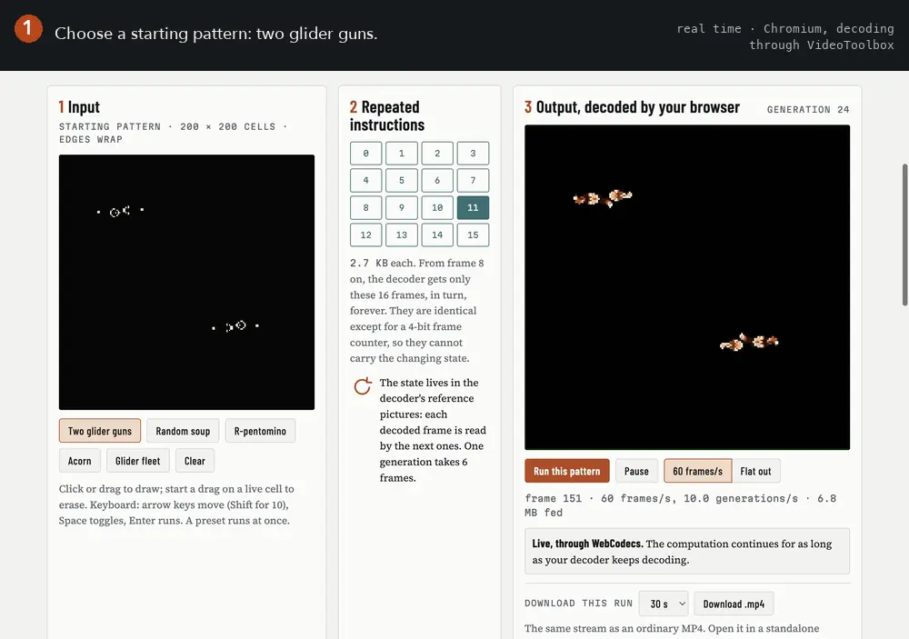

# H.264 CPU

**Can a video decoder execute a program?**

h264cpu compiles small computations into standard H.264 video streams. After a few start-up frames
that carry the starting state, the stream repeats the same 16 instruction frames, which differ only in
a cycling 4-bit frame counter. Each decoded picture supplies the state for the next step.

The examples run Conway's Game of Life and a small stored-program computer that finds primes. Their
evolving states are computed during decoding; they are not stored in the file.

Draw a starting pattern, watch your browser's decoder run it, then download the same experiment as an MP4.

**[Try it in your browser](https://fmindstormer.github.io/h264cpu/)** ·
**[Download a video](https://github.com/fMindstormer/h264cpu/releases/latest)** ·
**[How it works](#how-it-works)**

**What is in a file, and what computes.** MP4 is only the container. Inside is an ordinary H.264
stream: a few frames of raw samples that hold the starting state, then 16 small *program frames*,
repeated for as long as the video lasts. The computation is H.264's explicit weighted prediction, a
feature meant for fades:[^boyce] each block of a program frame copies blocks of earlier decoded pictures,
scales them by constant weights and adds them. The program frames never change, apart from that
counter, so they cannot hold the evolving state. It lives in the decoded pictures, which the decoder keeps as references for the next frame.

<picture>
  <source media="(prefers-reduced-motion: reduce)" srcset="docs/images/explainer.png">
  
</picture>

*The page, recorded in real time in Chromium (29 s). The instructions repeat while the state changes: the
highlighted square cycles through the same 16 program frames as the board evolves. The same idea
[as one still image](docs/images/explainer.png): the starting state is written once, the 16 program frames
repeat, and the only path from one generation to the next is through the decoder's own reference pictures.*

## Try it, or download it

**In the browser.** [The page](https://fmindstormer.github.io/h264cpu/) writes the stream in JavaScript
and hands it to your browser's H.264 decoder through WebCodecs, frame by frame, for as long as the tab is
open. JavaScript builds the starting frames and feeds the stream; the decoder computes every state after
that. Where WebCodecs can't decode H.264, the page plays a finite 60-second MP4 instead, and says so.
Each run can be downloaded as an MP4 and opened in a standalone player.

**Files.** Five 30-second videos at 60 fps, in the [v1.0 release](https://github.com/fMindstormer/h264cpu/releases/latest)
with their SHA-256 checksums:

| Video | What the decoder computes | Picture | In 30 s | Size |
|---|---|---|---|---|
| `life.mp4` | Conway's Game of Life (B3/S23) on a 200×200 torus, with a glow | 400×400 | 298 generations | 10.0 MB |
| `primes.mp4` | The Wireworld computer's instruction set, running Michael Fryers' prime program; a seven-segment display shows each prime | 592×208 | 104 instructions: 2, 3, 5, 7 | 66.9 MB |
| `tunnel.mp4` | Life on a 128×128 torus, inside a 1920×1080 picture the decoder zooms and turns from its own previous frame | 1920×1080 | 299 generations | 46.4 MB |
| `spiral.mp4` | A 14-state cyclic cellular automaton on a 64×64 torus | 128×128 | 199 generations | 7.2 MB |
| `turing.mp4` | Multi-scale Turing patterns (reaction–diffusion patterns, not Turing machines) on a 104×104 torus | 208×208 | 1,793 steps | 21.6 MB |

*`tunnel.mp4`: each streak is the history of one cell on the board's edge, one notch per generation.*

*`primes.mp4`, played at four times speed: the decoder executes the program and shows 2, 3, 5 and 7.*

<table>
<tr>
<td></td>
<td></td>
<td></td>
</tr>
<tr><td><code>life.mp4</code></td><td><code>spiral.mp4</code></td><td><code>turing.mp4</code></td></tr>
</table>

## How it works

**One macroblock is one instruction.** In a B frame, each 16×16 macroblock is predicted from up to two
earlier pictures: a motion vector says where to copy from, and explicit weighted prediction mixes the
two copies, for every sample, as

    clip(((w0·a + w1·b + 2^L) >> (L+1)) + o)

with constant integer weights and offsets.[^h264] These files send no residual and switch the deblocking
filter off, so every decoded sample is exactly that prediction. One op is two loads from earlier frames,
a multiply-add with constant weights and a saturating 8-bit store, for every sample of a region at once.

**Fields, a clock and memory.** A program is a set of *fields*, boards of cells in their own regions of
one large frame. In every program frame, one op rewrites each field from other fields, read up to 15
frames back at fixed offsets. A frame is a clock tick, and the decoder's reference pictures are the
memory. Ops with constant weights give saturating add and subtract, thresholds, min, max and every
logic gate, so a program is a circuit. Life's rule is 18 fields, at most 6 ops deep, so one generation
takes 6 frames.

**The same 16 frames, forever.** A program frame's slice headers count frames in a 4-bit `frame_num`,
and nothing else in the frame changes from one frame to the next. So the file is 16 distinct program frames,
repeated. Whatever changes from one generation to the next must come from the decoded pictures.

**The CPU addresses registers through circuitry.** Motion vectors are part of the program frame, so no
op can read a register chosen at run time. The CPU stores its 64 registers as rows of one field, reads
all of them in every instruction, and keeps the row the instruction names, using masks and ORs. Its
circuit is 334 fields, and one instruction takes 17 frames.

More: [how it works, in detail](notes/how-it-works.md) (the computation model, the bitstream, fitting
level 5.1, players, the browser) and [the programs, field by field](notes/programs.md).

## How it is checked

Every program has an exact NumPy model of what a decoder must output, and real decoders must agree with
it in every sample of every frame.

| Claim | Evidence | Test or command |
|---|---|---|
| The instructions repeat, and do not hold the state | after start-up, every frame is one of the same 16; Life from two different patterns gives identical program frames | `tests/test_web.py::test_program_frames_do_not_depend_on_the_start` |
| The decoder computes exactly what the model says | ffmpeg's decode equals the simulation in every sample of every frame | `tests/test_programs.py` (3 s of each program); `python -m h264cpu <program>` (the 30 s release files) |
| Life follows the intended rule | the decoded board equals an independent NumPy Life after every generation | the same |
| The CPU executes its instruction set | registers, program counter, instruction register, display and carry, read from decoded frames, equal a reference CPU after every instruction | the same, for `primes` |
| Browser downloads match the compiler | the page's JavaScript writes the same `.264` and `.mp4` bytes as the Python writer | `tests/test_web.py` |
| A browser's decoder agrees | frames Chromium's decoder hands the page, sampled, equal the simulation | `tests/test_browser.py` |
| The release files decode exactly on two decoders | all 1800 frames of all five files, on ffmpeg and on Apple's VideoToolbox | [release record](notes/verification.md#release-verification-record) |

Quick check, about three minutes on an M4 Mac (needs ffmpeg and Node.js):

    pip install -r requirements.txt pytest
    pytest -q tests/test_writer.py tests/test_programs.py tests/test_web.py
    # 12 passed

The whole suite adds the browser tests (`npm install --prefix tests/browser` first; on Linux, `xvfb-run`)
and runs in CI on every push. Rebuilding and fully checking a release file:

    python -m h264cpu life              # ends: checked: 1800 of 1800 frames ... identical ...; 298 generations equal the reference
    python -m h264cpu primes --hwaccel videotoolbox    # the same on Apple's hardware decoder

These are four different kinds of evidence (short automated runs, full release verification, sampled
browser frames, and playback by eye), and [the verification notes](notes/verification.md) keep them apart.

## Limits and compatibility

- **Finite machines.** Life is Turing complete on an unbounded board,[^ww][^rendell] but each file here
  has a fixed board and the decoder a fixed number of 8-bit reference pictures, so each file is a
  finite-state machine. The model computes any Boolean circuit or finite-state machine that fits the
  frame and the level's macroblock rate. For scale, the 334-field CPU uses 66% of level 5.1's rate at
  60 fps.
- **Fixed programs.** A file's program frames are fixed when it is written. Only the starting state
  varies: on the page, the Life pattern you draw; the CPU's program is part of its starting state, but
  the page always starts it the same way.
- **Size.** The starting state is stored as raw samples, 0.8 to 5.1 MB per file.
- **Decoders checked frame by frame:** ffmpeg (6.1 on Linux, 9.0 on macOS), Chromium's decoder in
  Electron (software on Linux, VideoToolbox on macOS), and Apple's VideoToolbox through ffmpeg, on an M4
  Mac. ffmpeg 9's arm64 NEON code has a weighted-prediction bug these files don't trigger
  ([details](notes/development.md)).
- **Not yet checked:** phones, Windows Media Foundation, and GPU decoding in browsers on Windows and
  Linux. That a browser offers WebCodecs[^webcodecs] does not show that its decoder computes these
  streams correctly; if a player shows something else, please open an issue naming it.
- **Speed.** A decoder slower than the program's macroblock rate runs it slower, never skipping a frame.
  On an M4 Mac, ffmpeg decodes Life at about 900 frames a second (150 generations) and the CPU at about
  790 (46 instructions); Chromium's page runs them at about 650 and 620 frames a second.

## Prior art

One earlier work computes in a video decoder: Video2NAND (2026), which draws combinational logic gates
in a single VP8 frame.[^v2n] Its circuits settle within one frame; here inter frames carry state from one
frame to the next. I found no earlier video file whose decoder carries state across frames, in a search
in October 2026; that is not proof that none exists. Related work on computing image decoders, glitch
art and programmable media, with citations: [prior art](notes/prior-art.md).

## More

| | |
|---|---|
| [How it works](notes/how-it-works.md) | one macroblock as one instruction; the computation model; from a program to frames; level 5.1; players; running forever in a browser |
| [The programs](notes/programs.md) | Life in 18 fields, spiral waves, Turing patterns, the tunnel's fractional motion, the CPU |
| [How it is checked](notes/verification.md) | every check, the four kinds of evidence, the release verification record, clock speed |
| [Prior art](notes/prior-art.md) | Video2NAND, JPEG XL art, FORCEDENTRY, datamoshing, programmable media |
| [Notes from the work](notes/development.md) | the ffmpeg NEON bug, frame_num's limit, the Wireworld detour, and other findings |

**Run it**

    pip install -r requirements.txt     # numpy and Pillow; the checks also need ffmpeg on PATH
    python -m h264cpu life              # writes out/life.264 and out/life.mp4 and checks every frame
    python -m h264cpu tunnel            # 1920x1080; checking all 1800 frames takes a few minutes
    python -m h264cpu primes            # the CPU; checks the machine's state after every instruction
    python -m h264cpu spiral --seconds 10
    python -m h264cpu turing --no-check
    python -m h264cpu glassbox life     # the whole frame, labelled (needs ffmpeg with libx264)
    python -m h264cpu web               # rebuilds the page in docs/ from web/

To write a new program, start from `h264cpu/programs/life.py`, about 100 lines: the ops, a placement of
the fields, and a starting state. For a picture field and its warp, see `tunnel.py`; for a circuit of
gates scheduled for you, `circuit.py` and `primes.py`.

**Files**

| Path | What it is |
|---|---|
| `h264cpu/vsim.py`, `interp.py` | Exact integer models of weighted prediction and of quarter-pixel interpolation. |
| `h264cpu/writer.py`, `mp4.py` | The bitstream writer and a minimal MP4 muxer. |
| `h264cpu/machine.py`, `layout.py`, `circuit.py` | Fields and ops to slices, reference lists, motion vectors and frames; the simulator and level checks; placement; circuits of gates. |
| `h264cpu/programs/` | `life.py`, `spiral.py`, `turing.py`, `tunnel.py`, `primes.py`. |
| `h264cpu/verify.py`, `glassbox.py` | Decoding with ffmpeg and comparing every frame; labelled views of the whole frame. |
| `web/`, `h264cpu/web.py` | The page's source: `page.html` and `h264cpu.js`, the stream writer and WebCodecs player. |
| `docs/` | The built page, for GitHub Pages; generated, and CI checks that it is up to date. |
| `notes/` | The detailed write-up. |
| `tools/` | The scripts that make the README's recording and still image from the real page and decoder. |
| `tests/` | Writer, program, browser-parity and page tests. |

The page's source is in `web/`; `python -m h264cpu web` regenerates `docs/` from it.

## License

MIT. See [LICENSE](LICENSE). Michael Fryers' prime program and the Wireworld computer's design are the
work of their authors, credited above;[^owen] the program's 37 register words are reproduced from Mark
Owen's description to run it.

[^boyce]: J. M. Boyce, "[Weighted prediction in the H.264/MPEG AVC video coding standard](https://doi.org/10.1109/ISCAS.2004.1328865)", *Proc. IEEE ISCAS 2004*, vol. 3, pp. 789–792.
[^h264]: ITU-T, [Rec. H.264](https://www.itu.int/rec/T-REC-H.264), *Advanced video coding for generic audiovisual services*: weighted sample prediction in 8.4.2.3 (equations 8-274 to 8-276) and the constraint on w0 + w1 in 8.4.3 (8-298); fractional sample interpolation in 8.4.2.2; level limits in A.3.1, A.3.3 and Tables A-1 and A-4.
[^ww]: E. R. Berlekamp, J. H. Conway and R. K. Guy, *Winning Ways for Your Mathematical Plays*, vol. 2, ch. 25, "What Is Life?", Academic Press, 1982; [2nd ed.](https://doi.org/10.1201/9780429487309), vol. 4, A K Peters, 2004.
[^rendell]: P. Rendell, "[A Turing Machine in Conway's Game of Life](http://rendell-attic.org/gol/tm.htm)" (2000) and "[A Universal Turing Machine in Conway's Game of Life](http://rendell-attic.org/gol/utm/index.htm)" (2010); see also his book [*Turing Machine Universality of the Game of Life*](https://doi.org/10.1007/978-3-319-19842-2), Springer, 2016.
[^webcodecs]: MDN, [VideoDecoder browser compatibility](https://developer.mozilla.org/en-US/docs/Web/API/VideoDecoder#browser_compatibility): Chrome and Edge 94, Safari 16.4, Firefox 130 (not Firefox for Android).
[^v2n]: firer, "[Video2NAND](https://sharedobject.blog/posts/vp8-combinatorial-logic/)", *Shared Object*, 11 July 2026.
[^owen]: M. Owen, "[The Wireworld computer](https://www.quinapalus.com/wi-index.html)", Quinapalus, 2004: the design by David Moore and Mark Owen (1990–92), its [instruction set](https://www.quinapalus.com/wires10.html), and Michael Fryers' prime program with its disassembly ([the final design](https://www.quinapalus.com/wires11.html)).
