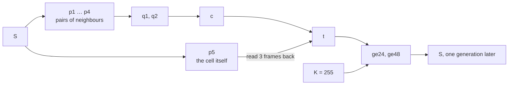
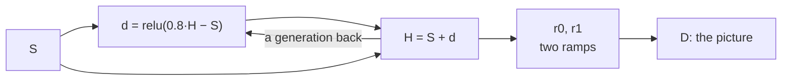
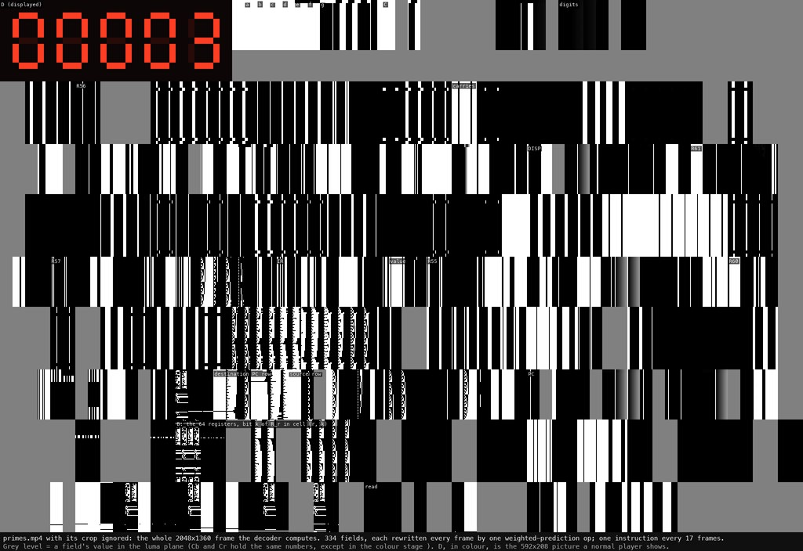

# The programs

[← Back to the README](../README.md)

The five programs, field by field: Life, spiral waves, Turing patterns, the Life tunnel, and the CPU.

## Life in 18 fields

| Field | Weighted prediction | Value |
|---|---|---|
| `p1` … `p4` | (8·a + 8·b + 64) >> 7, L = 6, two neighbours each | 16 per live neighbour (cells are 0 or 255) |
| `p5` | (2·a + 32) >> 6, L = 6 | 8 if the cell itself is alive |
| `q1`, `q2`, `c` | a + b, then a + b − 16 | 16 × neighbours − 16 |
| `t` | c + p5, with p5 read 3 frames back | 16 × neighbours + 8 × alive − 16 |
| `ge24`, `ge48` | steep weights against a constant field `K` | 255 if t ≥ 24; 255 if t ≥ 48 |
| `S` | ge24 − ge48 | alive next ⇔ 24 ≤ t ≤ 40 ⇔ 3 neighbours, or 2 and alive |
| `d`, `H` | relu(0.8·H − S), then S + d | a glow: max(alive, 0.8 × last generation's glow) |
| `r0`, `r1`, `D` | two ramps, then one three-colour mix at L = 6 | the picture |

Every arrow is a read from an earlier frame. The rule is a six-stage pipeline from the board back to
the board, so the board advances every 6 frames:

The picture is a glow, then a colour map:

## Spiral waves

`spiral.mp4` runs the cyclic cellular automaton of Robert Fisch, Janko Gravner and David Griffeath:[^cca] 14 states on a 64×64 torus, where a cell
advances to the next state when a neighbour already holds it. States are stored as 9k, from 0 to 117.
Spaced out like that, comparisons with integer weights can tell a neighbour one state ahead from every
other difference, including across the wrap from 13 back to 0. One generation takes 69 fields and 9
stages:
- neighbour differences, `g0` … `g7`: 127 + neighbour − cell;
- comparisons against `K`, `up`, `hi` and `wr`, that pick out a neighbour exactly one state ahead
  (`win`), including across the wrap;
- an OR tree, `t1` … `adv`: does any neighbour match?
- the next state: `u` = cell + 9, `z` = 255 if the cell is in the last state, and `nx` = u, or 0 where
  `z` is set;
- selection: `keepN` keeps the next state where a neighbour matched, `keepO` the old one elsewhere,
  and `S` adds them.

## Turing patterns

`turing.mp4` runs Jonathan McCabe's multi-scale Turing patterns[^mccabe] on a 104×104 torus, in 70 fields.
Turing patterns are the reaction–diffusion patterns of Alan Turing's 1952 paper on morphogenesis;[^morph]
they are not Turing machines, and this program is not one.

- **A blur pyramid.** `T1` … `B5` are pairs of averages, each level twice as wide as the last. At L = 6,
  (64a + 64b + 64) >> 7 is exactly (a + b + 1) >> 1.
- **Four scales.** At each scale, the activator (one blur) minus the inhibitor (the next) is taken apart
  into its sign and its size.
- **A min tree** (a − relu(a − b), two frames per level) finds the scale where the two blurs differ
  least. That scale moves the cell towards its activator, by a step of 1 to 3.
- **A slow pull** keeps values away from the clipping edges, in place of McCabe's normalisation.

The state takes one step every frame, using blurs a few frames old. That lag is the price of one layer
per frame, and the patterns still form.

## The tunnel: fractional motion

`tunnel.mp4` adds a second kind of field. A *picture field* is a plain region of pixels, rewritten by a
*warp*: each of its macroblocks copies an earlier frame at its own motion vector, in quarter pixels,
then weights the result like any other prediction.

When a vector lands between pixels, the decoder interpolates (section 8.4.2.2 of the standard[^h264]):
- Half-pixel luma samples come from the 6-tap filter (1, −5, 20, 20, −5, 1) / 32, rounded and clipped.
  The centre half-pixel filters the unrounded vertical sums a second time.
- Quarter-pixel samples average two neighbours, rounding up.
- Chroma interpolates bilinearly, in eighths of a sample.
- Reads past the picture's edge are clamped to it.

`interp.py` models all of this exactly. With it, the decoder becomes a resampling engine:
- **The warp.** The board's display field `D` sits in the middle of a 1920×1088 picture field `T`, of which
  players show 1920×1080. Every frame, each of T's 7,904 macroblocks reads the previous frame where its
  centre was one frame ago: 3% nearer the centre, and turned back 0.8°.
- **The streaks.** `D`'s own op draws the board over its history every frame. So whatever leaves the
  board's edge streams outward on a spiral. Each streak is the history of one edge cell, and the notches
  along it are generations.
- **The fade.** The weight 62/64 fades the picture as it travels.
- **Colour, from rounding.** At a weight of 62/64, a value less than 16 from its target never moves,
  because the change rounds to zero.
  - A luma offset of −1 still pulls every streak down to black.
  - The chroma offsets, +5 for Cb and +3 for Cr, park the background at the edge of that dead zone, a
    deep blue. Aging streaks drift there from ember orange.
- **Layout.** The frame is 3712×1088. `T` sits at the top-left, and Life's other 17 fields sit in three
  bands to its right. Annealing places them so that no read reaches more than one band up or down,
  because a vector can reach only about 512 pixels vertically.
- **Load.** That is 15,776 macroblocks per frame: 96% of what level 5.1 allows at 60 fps. Unlike a board
  field's, none of T's macroblocks can be skipped: direct prediction never lands exactly on their
  quarter-pixel vectors.

*`tunnel.mp4` with its crop ignored, at half size (`python -m h264cpu glassbox tunnel`).*

## A CPU: the Wireworld computer's instruction set

The Wireworld computer is a stored-program computer built in Wireworld, a cellular automaton for
electronics.[^owen] Its instruction set is one instruction, `MOV Rd, Rs`, over 64 sixteen-bit registers.
The program and its constants live in the registers, and some registers compute:

| Register | Read | Write |
|---|---|---|
| R0 | 0 | the display |
| R1–R52, R60 | the value | the value |
| R53, R54 | R54 AND NOT R53; R53 AND NOT R54 | the value |
| R56 | R55 if R56 ≠ 0, else R57 | the value |
| R58, R59 | R58 rotated right; R59 rotated left | the value |
| R61 | R60 + R61, ones' complement | the value |
| R62 | NOT R62 | the value |
| R63 | the program counter | a branch |

Instructions are prefetched, so there is one branch delay slot. Michael Fryers' 24-instruction program
tests odd numbers for primality by repeated subtraction and writes each prime to R0.

**Why not run the Wireworld cells.** The computer's clock is 2,304 Wireworld generations per
instruction, because an electron must run up its register bank and back. A generation of Wireworld would
take at least five frames here, like a generation of Life, so one instruction would take about three
minutes. Built directly as a circuit, an instruction takes 17 frames, about 0.28 seconds: roughly 700
times faster.

**The machine.** Every field is 16 columns by 64 rows. Bit k of register r is cell (r, k), and a
one-word signal holds its word in every row. With the gates of [the computation model](how-it-works.md#the-computation-model):
- **Reading a register.** Motion vectors are fixed, so no op can point at a register chosen at run time.
  Instead, a decoder compares the instruction's six-bit source field with a constant that
  holds each row's own number, and ORs the mismatches along each row: then only the selected row is 0.
  AND the bank with that row, and OR all 64 rows together with a butterfly of cyclic row shifts (1, 2,
  4, ..., 32). The result is the word, back in every row, ready to be the next instruction's operand.
- **Writing.** The bank keeps every row except the destination's, which takes the value.
- **The computing registers.** R53 and R54 read the bank one row up or down; R58 and R59 read one
  column over, on the torus, so rotation is free. The adder is a carry-lookahead adder whose carries run
  cyclically round the 16 columns, which is exactly ones' complement's end-around carry.
- **The circulating carry.** Owen's write-up asks the reader to check that one subtraction in the
  program always gives "plus zero". In plain ones' complement, p + (−p) is `0xffff`, "minus zero", and
  the program would never find 3. The Wireworld adder runs continuously in a loop. When every bit only
  propagates, nothing decides the carry going round, so it keeps its last value, and p + (−p) is
  `0x0000` when a carry was circulating. The circuit keeps that bit as state too.
- **The display.** Bit k of R0 adds the decimal digits of 2^k into five digit sums; five carry steps,
  each counting which of the thresholds 10, 20, ..., 150 a sum reaches, give the decimal digits. A
  picture field draws the seven segments in 8×8 blocks, each reading its segment signal.

The critical path, from the instruction register through decoding, selecting, adding and writing back,
is 17 frames, so one instruction takes 17 frames and 17 copies of the machine are interleaved in the
pipeline. `circuit.py` schedules the gates: every op runs one stage after its latest input and reads
each input that many frames back, through relay copies where that would be more than 15 frames. The
whole machine is 334 fields in a 2048×1360 frame.

| Prime | 2 | 3 | 5 | 7 | 11 | 13 | 23 | 59 | 97 |
|---|---|---|---|---|---|---|---|---|---|
| Instruction | 1 | 13 | 42 | 86 | 195 | 295 | 914 | 5,790 | 15,999 |
| On screen at 60 fps | 1.1 s | 4.5 s | 12.8 s | 25.2 s | 56 s | 1 min 24 s | 4 min 20 s | 27 min | 76 min |

*`primes.mp4` with its crop ignored, at half size (`python -m h264cpu glassbox primes`). Words are copied
into all 64 rows of a field, hence the stripes.*

[^h264]: ITU-T, [Rec. H.264](https://www.itu.int/rec/T-REC-H.264), *Advanced video coding for generic audiovisual services*: weighted sample prediction in 8.4.2.3 (equations 8-274 to 8-276) and the constraint on w0 + w1 in 8.4.3 (8-298); fractional sample interpolation in 8.4.2.2; level limits in A.3.1, A.3.3 and Tables A-1 and A-4.
[^cca]: R. Fisch, J. Gravner and D. Griffeath, "[Cyclic cellular automata in two dimensions](https://www.math.ucdavis.edu/~gravner/papers/cca.pdf)", in *Spatial Stochastic Processes*, Birkhäuser, 1991, pp. 171–185.
[^mccabe]: J. McCabe, "[Cyclic Symmetric Multi-Scale Turing Patterns](https://archive.bridgesmathart.org/2010/bridges2010-387.html)", *Proceedings of Bridges 2010*, pp. 387–390.
[^owen]: M. Owen, "[The Wireworld computer](https://www.quinapalus.com/wi-index.html)", Quinapalus, 2004: the design by David Moore and Mark Owen (1990–92), its [instruction set](https://www.quinapalus.com/wires10.html), and Michael Fryers' prime program with its disassembly ([the final design](https://www.quinapalus.com/wires11.html)).
[^morph]: A. M. Turing, "[The chemical basis of morphogenesis](https://doi.org/10.1098/rstb.1952.0012)", *Philosophical Transactions of the Royal Society of London B* 237(641), 1952, pp. 37–72.
